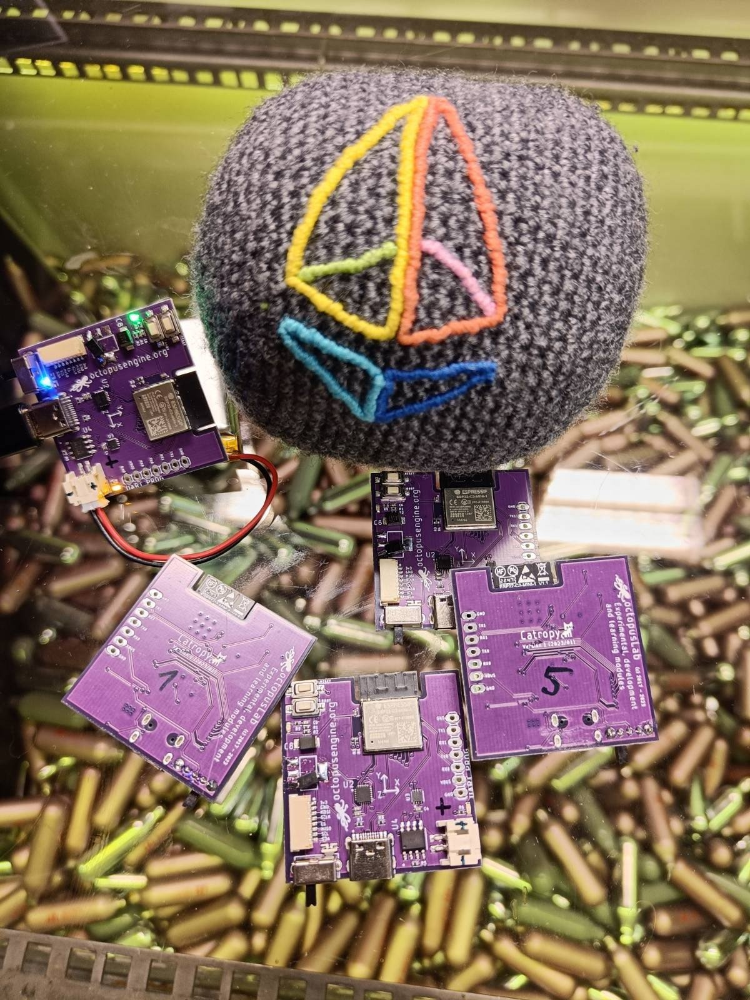
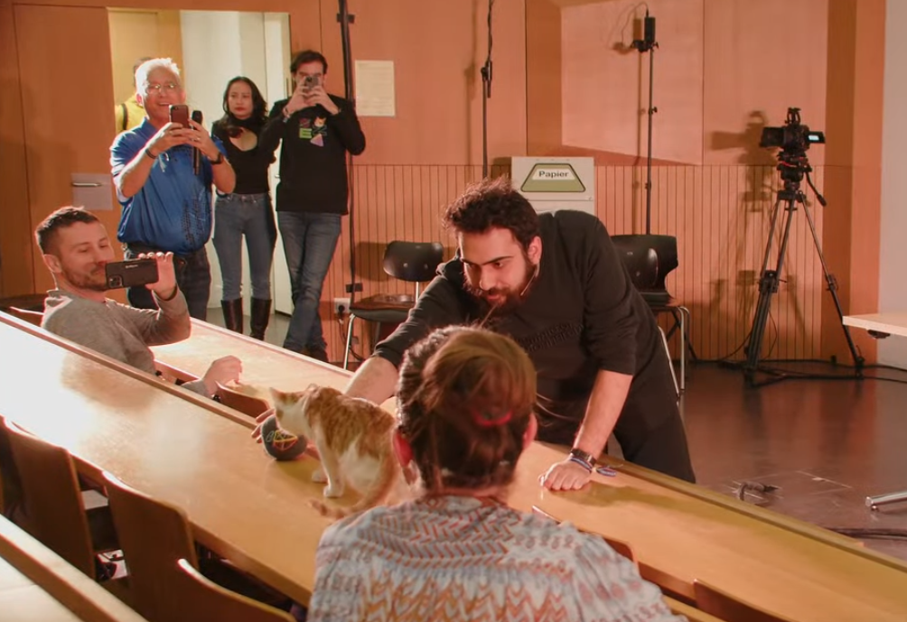
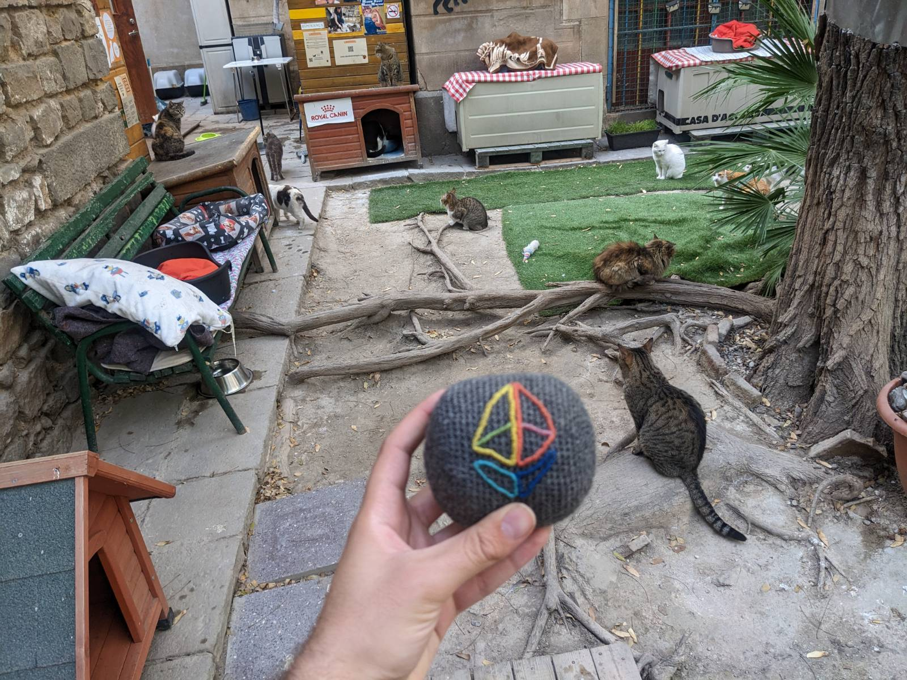

  <a href="./blog" style="text-decoration: none; color: #666;">ENG</a> | <strong>CAT</strong>

La història de les contribucions de Catropy a la Cerimònia KZG d'Ethereum. 

## Què és Catropy? 

Catropy és una implementació del mecanisme [Proof-of-Cat](./proofofcat.pdf) per assegurar la criptografia amb aleatorietat generada per gats. Fins i tot es podria anomenar un CRNG - Cat Random Number Generator (Generador de Nombres Aleatoris de Gat). 

La recerca i desenvolupament del tema i un dispositiu adequat per a la generació segura d'entropia va començar al voltant d'octubre de 2022 quan la [Cerimònia KZG d'Ethereum](https://github.com/ethereum/kzg-ceremony) s'acostava lentament. Des de la prova de concepte, el disseny del dispositiu s'ha revisat en 3 iteracions. El resultat és una placa personalitzada dedicada amb microcontrolador ESP32 C3 que utilitza giroscopi i acceleròmetre per recollir entropia del seu moviment. Quan l'entropia recollida arriba a una mida predeterminada, actua com a servidor proporcionant un punt final d'API amb un far d'aleatorietat. L'aleatorietat proporcionada és el resultat de mostrejar el moviment de 6 eixos en períodes aleatoris uniformes i passar-los a través de funcions de caos. El maquinari i el programari són oberts, troba tots els detalls a la documentació de Catropy [docs](./docs.md). 

Tot i que l'objectiu inicial era utilitzar el dispositiu per a contribucions a la cerimònia, és important tenir en compte que el dispositiu és multipropòsit i es pot utilitzar per a més que això. L'entropia creada es pot utilitzar per a qualsevol tipus d'aleatorietat, per exemple, per generar directament claus privades per a carteres criptogràfiques. Però a part del seu cas d'ús d'entropia, un dispositiu petit amb capacitats de computació generals i sensors de moviment és útil en diversos camps. Per exemple, hem col·laborat amb un metge que està experimentant amb l'ús en diagnòstics neurològics. El pacient porta el dispositiu a la mà i se li dóna una tasca de moviment i cognitiva específica. Mesurant amb precisió els canvis en el seu moviment durant l'exercici, el metge pot determinar problemes neurològics en diverses parts del cervell.

D'acord, ara tornem a la cerimònia. 

## Contribucions a la cerimònia

Com s'ha suggerit anteriorment, Catropy es va utilitzar àmpliament per a contribucions a la Cerimònia KZG d'Ethereum. Algunes contribucions van ser públiques i altres privades o individuals. Algunes fetes per gats reals, altres per persones.

El dispositiu utilitza funcions de caos deterministes i altres enfocaments per amplificar l'entropia generada del seu moviment, de manera que només un joc lleuger és suficient per crear una cadena aleatòria segura. Tot i que els gats van ser fortament preferits, també és possible que les persones juguin amb el dispositiu per considerar-lo segur. Especialment una multitud de persones en un esdeveniment pot ser una bona font d'aleatorietat. Per tant, es van fer múltiples contribucions públiques amb o sense gats.

Es van utilitzar les 3 versions del dispositiu per a la cerimònia amb al voltant de 25 plaques de v1 o v2 distribuïdes a la comunitat. Els dispositius es van distribuir inicialment als contribuents que van treballar en la creació del dispositiu i després a diverses persones de la comunitat d'Ethereum. La distribució del dispositiu es va centrar inicialment en els contribuents principals d'Ethereum que estaven interessats en utilitzar-lo i després en persones de la comunitat més àmplia que estaven disposades a donar una petita quantitat d'ETH a una organització benèfica de gats - [refugi a Barcelona](https://www.eljardinetdelsgats.org). 

La contribució a la cerimònia utilitzant Catropy va ser possible gràcies al [client Go KZG](https://github.com/jsign/go-kzg-ceremony-client/). El client permet extreure entropia d'un punt final http arbitrari que en aquest cas és servit pel dispositiu Catropy. La millor pràctica explicada a la documentació suggereix crear una WLAN privada d'un sol propòsit, per exemple, utilitzant un telèfon i un ordinador segur que executi programari de codi obert. En les contribucions en què vaig ajudar, es van utilitzar diversos dispositius segurs. A part d'altres, es van utilitzar Purism Librem amb Qubes, Pinebook Pro i Rpi4 com a dispositius que executen el client i Pixel 5a amb GrapheneOS, router OpenWRT i [Banana phone](https://sites.google.com/view/bananahackers/root/temporary-root) proporcionant el punt d'accés. Per a una sola contribució, també es va utilitzar el [client cpp](https://github.com/PatriceVignola/cpp-kzg-ceremony-client) amb entrada stdin des de Catropy.

Durant el primer període de contribució oberta, vaig organitzar múltiples trobades públiques per explicar la cerimònia i tenir persones que contribuïssin amb la seva entropia. La primera, utilitzant el dispositiu v0, va ser a Àustria amb al voltant de 100 desenvolupadors principals d'Ethereum contribuint amb la seva entropia. Després n'hi va haver una a [Praga](https://twitter.com/TMIYChao/status/1627728244693733383) assistida per ~20 persones i una a [Denver](https://twitter.com/TMIYChao/status/1631385387901030401) assistida per 10 persones. A més, [EPF Day](https://www.youtube.com/watch?v=oF_BRlXMVNY) a Denver on també vam fer la cerimònia Catropy amb al voltant de 20 persones. 

A part d'això, algunes persones de la comunitat que van obtenir el dispositiu també el van utilitzar per contribuir individualment. Notablement, [pk910](https://twitter.com/_pk910_/status/1632706164231118848) fins i tot va fer un [fork](https://github.com/taxmeifyoucan/proof-of-cat/compare/master...pk910:proof-of-cat:master) del codi per fer-lo més adequat a les necessitats del seu gat. Com que el seu gat és més juganer a la nit, va fer que el dispositiu dormís en períodes i així funciona tota la nit en lloc de pocs minuts de recollida d'entropia. 

Per a les contribucions especials, vaig reservar una ranura durant EthZurich. Vaig donar una xerrada i vaig utilitzar el dispositiu per recollir entropia de la multitud + un [gat](https://twitter.com/0x_Ytocin/status/1647291053429456903) de Bielorússia anomenat Júpiter. La sessió va ser [gravada](https://www.youtube.com/watch?v=Nqg8KdmP-_g) però no la contribució real. Per a això, vaig utilitzar una Raspberry Pi nova com a dispositiu per a la computació fora de línia i vaig transferir-hi dades d'entropia de Catropy només utilitzant `adafruit-ampy`. El pla inicial era realitzar tota la computació al dispositiu Catropy però el microcontrolador és de molt baixa especificació per a això. La targeta SD del RPi es va utilitzar només una vegada i es va destruir però el dispositiu està a la prestatgeria ara mateix, no tinc el cor de destruir-lo. 

Aquí hi ha algunes contribucions a la cerimònia que van passar utilitzant Catropy sota la meva mà: 

Consulta-les al transcripció de la cerimònia: 

- 0xe83E0b36bc68c1407B81B6d42CA4bd23FC309517
    - PoT keys:
        - (2^12): `0xa8fe93f7e12d9a8da8564a6542c3d0ae376af16198844f0eb26ce86716fab80b2ed4baff77dea01120e066d95c6ff18d036e48fa19a65e5e3ed3afd86f02cf3e7de46056bad979594cc0277cd0c0bd2cc959b9210e9cd4702eab24795e5e1f0c`
        - (2^13): `0xa96319fb15cdb7fca6efd8e9338075bc5770a04a58c6e07b5da2b1742c21caceaa64990ab8b091ca6800bdf5b0a695b200fdf660bb1de7be6ae407fef9a8d40394dd8443a39fd3ebc671cab0211a21c992e2ea88aecb8a51e0ee33bb1b21be30`
        - (2^14):
        `0x8256a628082d2013a7fc5c7c310e28ce613861e3c0019a407491fa21554978493571242d019efc945ef765080616af6703877a6ede651e150e10a8808982c3c5a83871caed11970db8be3654fd84623a3abe0c695b490e7d5da900e0f7ebc846`
        - (2^15):
        `0x8614699c6b9c7970b5747beade6f1cdd03f86b699324251ce223ab73d63eb74e97b43e37929257851d01955c3577f95119a68a3fc213f9b413bf0b2e391c76fa59546bbd61cd5928249655368317b7fb53e0468afd9d71df6ba2a2f8acc8c266`

- 0xDB08c59302e8449fb5f2F6CCf7DDE974E678A31f
    - PoT keys:
        - (2^12):
        `0x90bb2d0b11f285ed5a9cf06ed435c42dec65e98f7d31a6569d21360ed62ad2e6160d8eec56bddb32c6c0c50b8333908016d1d3684208522be38e5c4d968800fa09d048a5711a5d286c31e5b39861ce2adf65ee4c401569eea12a15a9be2d8125`
        - (2^13):
        `0x8e9ea8bd5cde8c3ec463533850373b1403f906292fb87758e09e42cae4836a3d79ea210f5d117e99b9b84af2e9978ecd197e2a9488c7eaef27e54a8fd4c77190b844edf8378b46a84fef2a0054cf1d53371944edb1a409b2d4dfcdecc3523ae1`
        - (2^14):
        `0xb258f5e8c3b413f594a1e97f797d246a12c0e669bb6d75cbb5fe97e467528fdc3429beabb51b352d162f768a33d366bf022a0a2f35a6ab70f714bd3bbccbb8dff3751bfb86243e18a81a92dba5870d692c910ae757675106a0dac41682382798`
        - (2^15):
        `0x995bc110eff9b401282d4674753f8dff975d78601f1a3695e1c14f99af0b58bf8acf47c1bfff5e3d9100fef5bb2b8a140a415551034eb9494775c512ee5cc9fc47f031dad6b454f96ecd8632e94306ca8f4decf67c6e6a3974a46cba586d84dc`

- 0xD0Ed0acb335E4fb02dF3bE93396d162E0F1eC5a3
    - PoT keys:
        - (2^12):
        `0x9290b4b5fcebdbcf6b5bee06247b8228a401050b6f97939d486c4f244809c2fc61884659ca1d1577b9c75af699d3bd70192ad3ea4198ba307dd8cbfd46e23d0190012c2f7b84ceedfb03992fece56c3d23a9711b249b4d98a30462af10ba2f32`
        - (2^13):
        `0xaa0dc81a6cdbebc6021ef4f1e1a39e46e5c8705b4e1899d2cef8adef96717cb1e908c6db0c36fa610e1404d2ffc475d803e130dc89b666589dbc9ed0aefded39c0d91534f5cd44aa823c14f0bbe7cca03b5f33f3c7caf52f2360fc570eb7a8fe`
        - (2^14):
        `0x83ad080b94d8ab5e9a3b4543834e38467ce3a2703b0a1a742a641b3f3503ed95df506967d5c9eff3c8b26ea2efb9c9200da471ebf9009fd980e84da6c808ca34331965ba46b2a0433ea32812f35d6505b20a2a1d73bf126b0b67157c94f5e774`
        - (2^15):
        `0xaadbae94ee2b5226a38d634752cadee1e6f1c7f8221196c338e40553e8944a5793603ffe16e73d83ae3fb8eb4db08f260b01aa708f6dc889bd461567f4166ca62d0664335e7b3befcb101a521ddea8495ec705368e18b08370344880c1410b19`

En total, basant-me en les meves estimacions aproximades, al voltant de 20+ gats estan assegurant Ethereum en el moment d'escriure això. 

