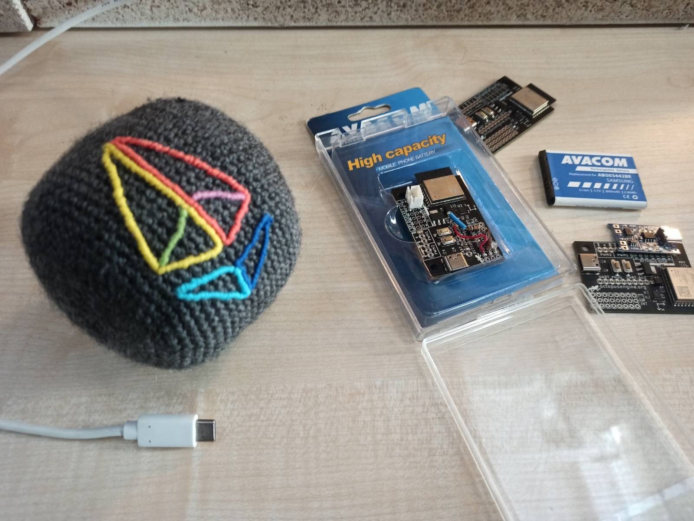
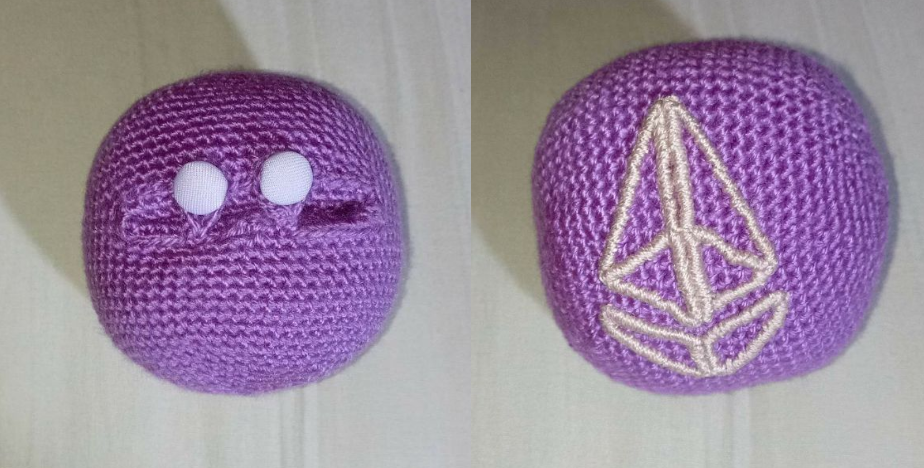
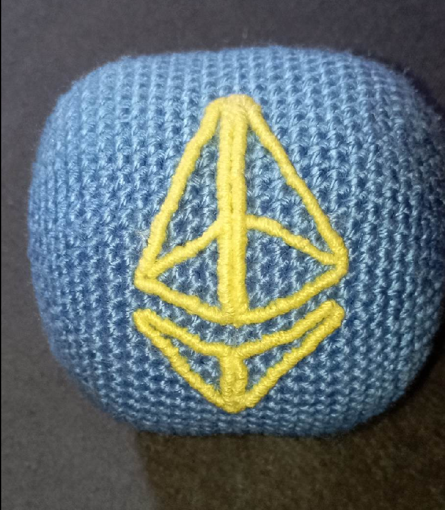
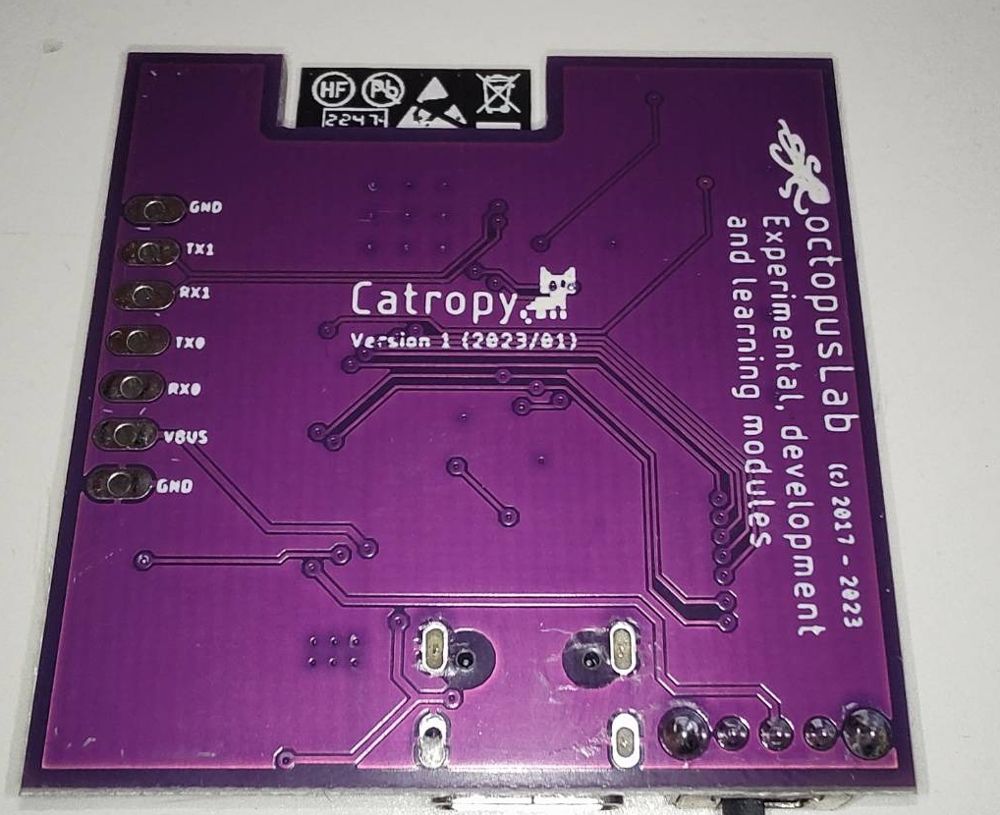

  <a href="./index" style="text-decoration: none; color: #666;">ENG</a> | <strong>CAT</strong>

# Proof-of-Cat: El gat com a generador d'entropia

Proof-of-Cat és un enfocament innovador per generar aleatorietat per a sistemes criptogràfics, utilitzant la impredictibilitat inherent i l'entropia dels felins domèstics, també coneguts com a gats.

Per saber-ne més, llegeix el **[CatPaper](./proofofcat.pdf)** i consulta la **documentació de Catropy [docs](./docs.md)**. 

## Catropy

_Catropy_ és un CRNG (Cat Random Number Generator - Generador de Nombres Aleatoris de Gat) dissenyat com a implementació de Proof-of-Cat. La recerca i desenvolupament d'aquest dispositiu estava pensada per participar a la [Cerimònia KZG d'Ethereum](https://github.com/ethereum/kzg-ceremony) i va ser suportada per una beca de l'EF. Llegeix el [blog](./blog_cat.md) sobre com Catropy utilitza gats per assegurar Ethereum.

És bàsicament una joguina que pot generar aleatorietat del seu moviment. La placa de circuit és un microcontrolador amb wifi i bateria que permet utilitzar el dispositiu completament de forma remota. Per saber-ne més sobre el disseny del maquinari i l'ús, consulta la [documentació](./docs.md). 

La joguina no és només una placa de circuit. Ve en una pilota de punt fet a mà que protegeix l'electrònica i proporciona una experiència suau. S'ha demostrat que funciona bé no només amb [gats](https://twitter.com/i/status/1632706164231118848), [sinó també amb desenvolupadors principals](https://twitter.com/liamihorne/status/1617974952413761536). Hi ha diverses versions i combinacions de colors disponibles. Consulta les imatges d'exemple a continuació. 

El dispositiu es pot utilitzar per contribuir a la Cerimònia KZG però no és el seu únic propòsit. El programari Catropy et permet utilitzar-lo per generar entropia per a qualsevol cosa que la necessiti. Però el dispositiu és de propòsit general i pots reprogramar-lo per utilitzar el microcontrolador com vulguis. Per exemple, un altre cas d'ús que s'està desenvolupant és utilitzar el dispositiu per al diagnòstic mèdic de pacients basat en el seguiment del seu moviment i els seus canvis. 

## Obtén un dispositiu Catropy

Catropy va ser dissenyat com a dispositiu de codi obert sense incentius de profit. Pots construir el dispositiu tu mateix però si vols comprar-ne un, ho pots fer fent una donació a un [refugi de gats a Catalunya](https://www.eljardinetdelsgats.org). Basat en una donació mínima de 0.02ETH, et recompensarem amb una joguina Catropy completament funcional. 

I si ets membre del Protocol Guild, la joguina és completament per part nostra! 

### Donació

Les donacions les gestionem nosaltres, les convertim a moneda fiduciària i les donem físicament a [El Jardinet dels Gats](https://www.eljardinetdelsgats.org), una organització sense ànim de lucre que ajuda els gats i que també va estar involucrada en les proves de la joguina Catropy. En cas que rebem un nombre elevat de donacions (0.5ETH+), es repartiran entre Jardinet i una altra [organització local](https://www.degats.org/) amb múltiples colònies. L'adreça oficial de donació és catropy.eth (0x543cbBD2bf6f6eC71254E75b7FEAbb222B143343). Tots els fons d'aquesta adreça es donaran per ajudar amb les despeses del refugi: menjar, materials, revisions veterinàries, tractament i vacunacions. 

### Enviament 

Pots recollir Catropy personalment durant la conferència **EthPrague** o la resta de l'any a [Paralelní Polis](https://goo.gl/maps/rJfCFSxNbkSRXrLw9) o a Barcelona. 

En cas contrari, podem enviar-lo a la teva adreça. Només afegeix la tarifa d'enviament a la teva donació, pots utilitzar una [calculadora d'estimació d'enviament](https://coolparcel.com/). (paquet de 0.5kg, enviament des de la República Txeca, 17001). No dubtis en contactar-nos si no estàs segur, podem enviar-lo primer i informar-te del cost exacte. 

### Com fer-ho

Pas a pas, així és com obtens el teu dispositiu: 

- Dona un mínim de 0.02ETH (al voltant de 30EUR) a catropy.eth o 0x543cbBD2bf6f6eC71254E75b7FEAbb222B143343. Pots utilitzar mainnet, Arbitrum, Optimism, Polygon, Gnosis chain o Aztec (zk.money, l'adreça és @catropy). Per donar a través d'altres xarxes, contacta'ns. 
- Tria una combinació de colors. Les pilotes venen en diversos colors, hem preparat gris amb el logotip ETH colorit, rosa amb logotip blanc i blau amb groc. Consulta les imatges a continuació i més a la [directori d'assets](https://github.com/taxmeifyoucan/proof-of-cat/tree/gh-pages/src/assets). Si desitges la teva pròpia combinació de colors, no dubtis en escriure'ns però tingues en compte que podria trigar uns dies addicionals abans de l'enviament. 
- Envia'ns un correu electrònic a meow@proofof.cat amb les teves dades d'enviament (la teva adreça o opció de recollida), el color triat i signa'l amb l'adreça des de la qual vas enviar la donació. Signar un missatge amb una cartera és fàcil, pots utilitzar una eina com [MyCrypto](https://app.mycrypto.com/sign-message). Si ets membre del Protocol Guild, signa'l utilitzant la teva adreça PG o simplement contacta'ns per verificar que ets realment tu. 
- Abraça el caos 

## Contacte

Per a suport, comandes i qualsevol tipus de preguntes, si us plau contacta'ns a meow@proofof.cat

 

